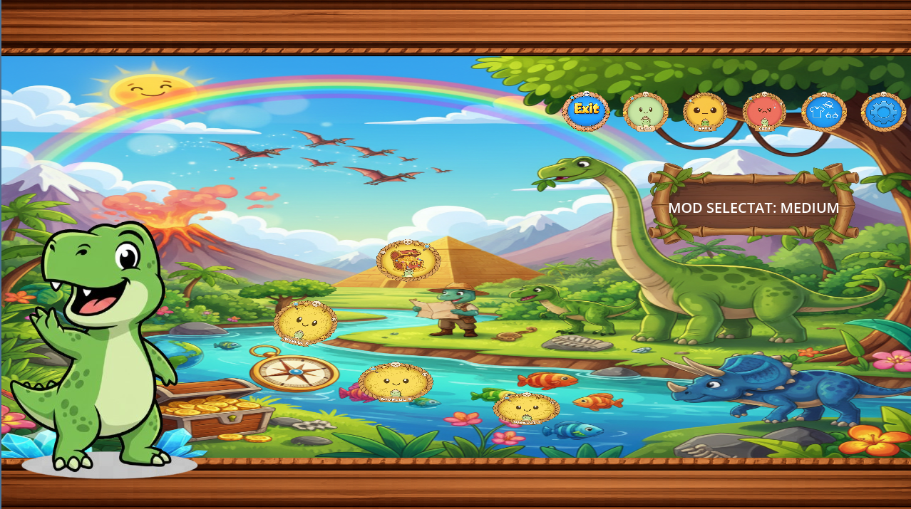
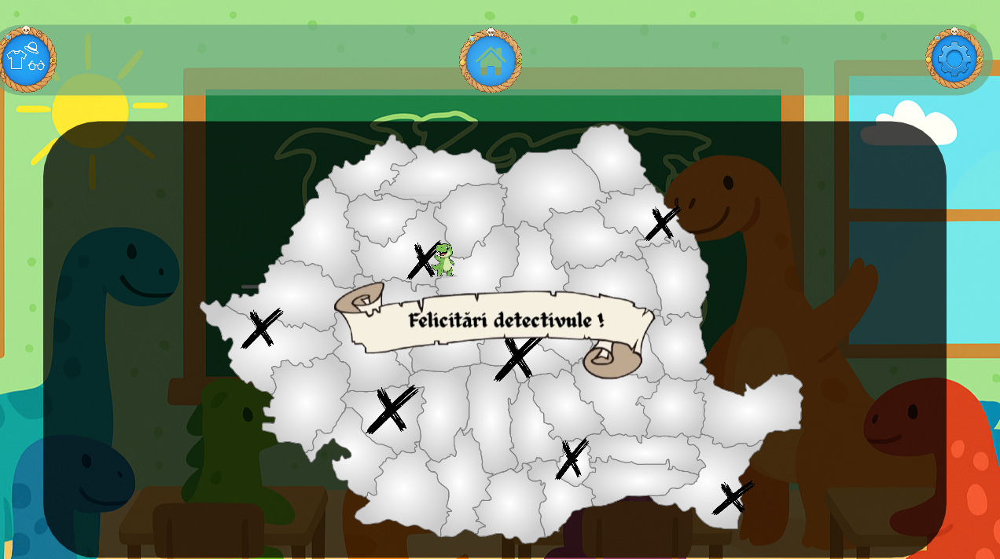

# Geography Learning App

An interactive 2D educational game for fourth-grade pupils to learn Romanian geography through play. Built with the Godot Engine as a mobile-first tablet application used during classroom sessions. Developed as a university team project at Babeș-Bolyai University in a team of 10.

## My Role

Contributed as **Frontend Developer**:

- Designed and built the **main interface** with all the levels and difficulty buttons, the Sound Settings window, and the Customization System using earned saved points.
- I also created the FINAL BONUS LEVEL at MEDIUM DIFFICULTY featuring a map of Romania with Pins. The children need to click the pin corresponding to big cities in Romania in the correct order, according to the info gradually appearing on the side of the screen. At the end, they discover Dino, the main character!

## About

Traditional geography lessons in Romanian primary schools often rely on blackboard-and-textbook methods. This app was built with a local fourth-grade teacher and her class as active partners, replacing rote memorization with tablet-based mini-games. Pupils play during class sessions, making learning interactive and fun.

## Screenshots


*Main menu — pupils select their difficulty level from here.*


*Medium Level 2: pupils drag Romanian counties into their correct positions on the map.*


*Hard Level 1: "Hartă mută" (blank map) — pupils match numbered waters and cities and crosshatched geographical regions with their names. Immediate feedback on each match.*


*Medium Level Bonus: pupils click the cities of Romania in the correct order.*

## Features

- **12 educational games** across 3 difficulty levels (Easy, Medium, Hard)
- **4 games per level**, with the final game of each level being a special challenge round rewarded with a treasure chest
- **Progressive difficulty** — pupils advance through levels as they master content
- **Mobile-optimized** — designed for tablets used in classroom settings
- **Dynamic scene management** — smooth transitions between games and menus
- **JSON-driven content** — questions and configurations loaded from external data files for easy updates without code changes

## Game Structure

```
Easy Level              Medium Level            Hard Level
├── Game 1              ├── Game 5              ├── Game 9
├── Game 2              ├── Game 6              ├── Game 10
├── Game 3              ├── Game 7              ├── Game 11
└── Game 4 — Challenge  └── Game 8 — Challenge  └── Game 12 — Challenge
```

## Tech Stack

- **Engine:** Godot Engine 4.x
- **Language:** GDScript
- **Data:** JSON (questions, game configurations)
- **Version Control:** Git and GitHub

## How to Run

### Prerequisites
- [Godot Engine 4.x](https://godotengine.org/download)

### Steps

1. Clone the repository:
```bash
   git clone https://github.com/Nikolas5516/ioc-learning-app.git
```
2. Open Godot Engine
3. Click **Import** → navigate to the cloned folder → select `project.godot`
4. Click **Run** (F5) to launch the app

For mobile testing, use Godot's **Remote Debug** feature or export to Android.

## Team

Developed by a team of 10 at Babeș-Bolyai University. Project managed using Scrum methodology with regular sprint reviews and continuous stakeholder feedback from the client teacher and her fourth-grade class. (We received the maximum grade :D)
